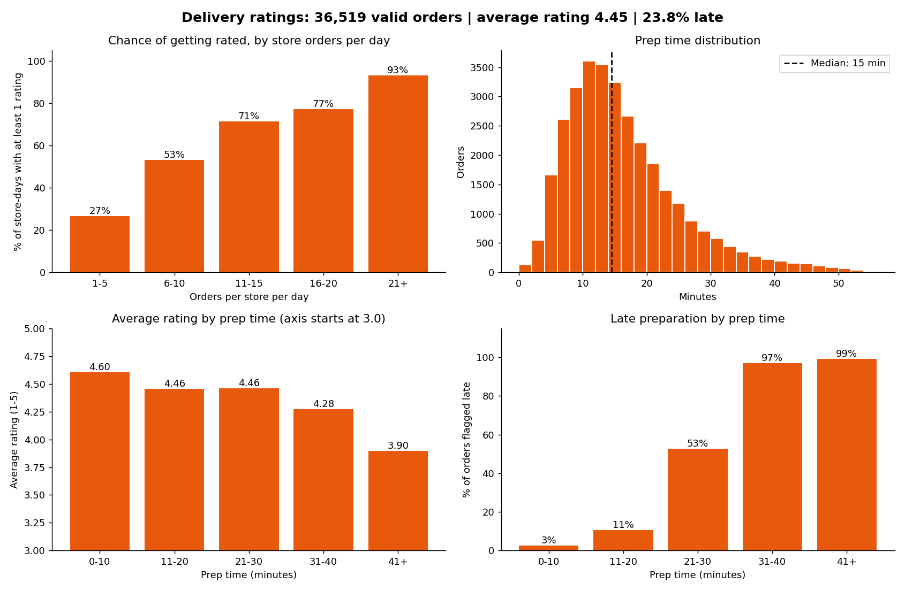

# Delivery Ratings Analysis: how order volume and prep time affect customer ratings

**English** | [Português](README.pt-BR.md)

**[Open the live dashboard](https://delivery-ratings-analysis.streamlit.app/)** (first load takes about 1 minute: the app reads ~40k orders; use the sidebar to switch between English and Portuguese)

Analysis of 40k orders from a multi-brand dark kitchen delivery operation (Sep–Oct 2026, anonymized data), answering one business question:

> How do order volume and kitchen prep performance (lateness and prep time) affect the ratings stores receive from customers?

Only about 1 in 10 orders is rated, so understanding what drives a store to be rated, and rated well, helps prioritize operational improvements.



## Key findings

| Question | Result |
|---|---|
| Does order volume change the **chance** of being rated? | Yes: from 27% (1–5 orders/day) to 93% (21+). Largely mechanical, since only 9.6% of orders are rated. |
| Does order volume change **rating quality**? | No: the share of 5-star ratings stays at 77–78% from 6 orders/day. |
| Does prep time change the rating? | Yes: average rating falls from 4.60 (up to 10 min) to 3.90 (41+ min); the drop accelerates after 30 min. |
| Where does prep become "late"? | Between 20 and 30 min (3% late up to 10 min; 53% at 21–30; ~98% above). |

**Takeaway for operations:** keeping prep time under 20–30 minutes protects the rating; getting more orders rated is a volume problem, not a prep-time problem.

**Limitations:** results are associations, not causal effects; only 9.6% of orders are rated (possible self-selection bias); the 41+ min bucket has only 134 ratings; store, brand and time-of-day effects are not separated.

## Data cleaning decisions

- **Merged** two order exports (Sep: 19,096 rows; Oct: 21,081) into 40,177 orders and 48 variables; 0 duplicate order IDs.
- **Cancelled orders removed** (3,658), leaving 36,519 valid orders: a cancelled order is not a sale and none had a rating.
- **Missing ratings kept as `NaN`:** null means the customer did not rate; filling it would invent a rating nobody gave.
- **Prep time of `0` treated as "not measured"** (the store never clicked "ready for pickup") and converted to `NaN`. Keeping zeros would have lowered the mean prep time from 16.8 to 14.9 min and inflated the 0–10 min bucket.
- **Type conversions:** prep time (text with decimal comma) to numeric; rating scale 100–500 to 1–5.
- **Engineered features:** prep-time buckets, orders-per-day buckets, store-day records, 5-star flag, month, brand.

The full methodology and conclusions are in the report (in Portuguese): [`Relatorio_Trabalho_Final.pdf`](Relatorio_Trabalho_Final.pdf). An English summary is in [`REPORT_SUMMARY_EN.md`](REPORT_SUMMARY_EN.md).

## Run it locally

```bash
git clone https://github.com/Silvairv/delivery-ratings-analysis.git
cd delivery-ratings-analysis
pip install -r requirements.txt
streamlit run app.py
```

## Project structure

| File | Purpose |
|---|---|
| `tratamento.py` | Data loading, cleaning and feature engineering |
| `app.py` | Streamlit dashboard (filters by month, city and brand) |
| `_Dados do pedido(...).xlsx` | September and October order exports (anonymized) |
| `Relatorio_Trabalho_Final.pdf` | Report with methodology and conclusions (Portuguese) |
| `REPORT_SUMMARY_EN.md` | English summary of the report |

**Stack:** Python, pandas, NumPy, Matplotlib, Streamlit.

## Roadmap

- [x] English version of the dashboard UI (language toggle)
- [ ] Compare brands and cities
- [ ] Control for store and time-of-day effects (regression)
- [ ] Faster data loading (Parquet instead of Excel)
- [ ] Automated tests for `tratamento.py`

## Data

Data is anonymized (stores and brands coded, customer comments removed). Shared for educational and portfolio purposes.
