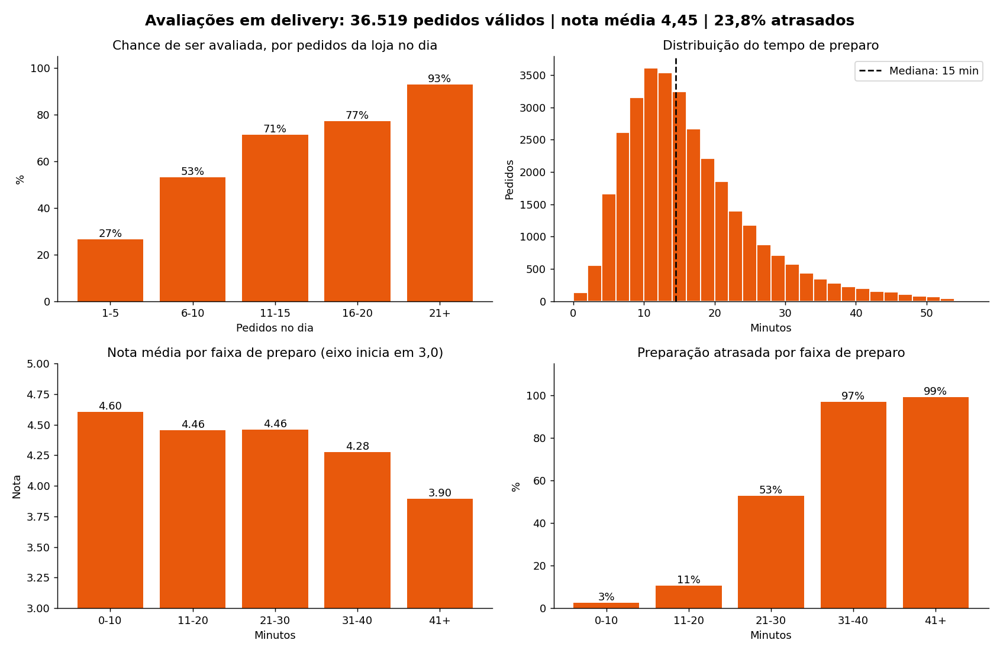

# Avaliações em Delivery: volume de pedidos e tempo de preparo

[English](README.md) | **Português**

**[Abrir o dashboard online](https://delivery-ratings-analysis.streamlit.app/)** (a primeira carga leva cerca de 1 minuto: o app lê ~40 mil pedidos; use a barra lateral para alternar entre inglês e português)

Análise de 40 mil pedidos de uma operação de dark kitchen multimarca (set–out/2026, dados anonimizados) para responder:

> Como o volume de pedidos e a performance de preparo (atraso e tempo de preparo) influenciam a avaliação que as lojas recebem dos clientes?

Só cerca de 1 em cada 10 pedidos é avaliado. Entender o que leva uma loja a ser avaliada, e bem avaliada, ajuda a priorizar o que melhorar na operação.



## Principais resultados

| Pergunta | Resultado |
|---|---|
| O volume muda a **chance** de ser avaliado? | Sim: de 27% (1–5 pedidos/dia) a 93% (21+). Em boa parte é efeito mecânico: só 9,6% dos pedidos são avaliados. |
| O volume muda a **qualidade** da nota? | Não: a proporção de notas 5 fica em 77–78% a partir de 6 pedidos/dia. |
| O tempo de preparo muda a nota? | Sim: nota média cai de 4,60 (até 10 min) para 3,90 (41+ min). A queda se acentua após 30 min. |
| Onde o preparo vira "atrasado"? | Entre 20 e 30 min (3% de atraso até 10 min; 53% entre 21–30; ~98% acima). |

**Limitações:** são associações, não causa; só 9,6% dos pedidos são avaliados (possível viés); a faixa 41+ min tem apenas 134 avaliações; a análise não separa efeito de loja, marca ou horário.

## Tratamentos principais

- Remoção de pedidos cancelados (3.658) → 36.519 pedidos válidos.
- Nulos de avaliação mantidos como `NaN` (nulo = cliente não avaliou).
- Tempo de preparo `0` tratado como "não medido" (loja não marcou pronto) e convertido em `NaN`.
- Nota convertida da escala 100–500 para 1–5.

A metodologia completa está em [`Relatorio_Trabalho_Final.pdf`](Relatorio_Trabalho_Final.pdf).

## Como rodar

```bash
git clone https://github.com/Silvairv/delivery-ratings-analysis.git
cd delivery-ratings-analysis
pip install -r requirements.txt
streamlit run app.py
```

## Estrutura

| Arquivo | Função |
|---|---|
| `tratamento.py` | Carga, limpeza (cancelados, zeros, tipos) e criação de variáveis |
| `app.py` | Dashboard Streamlit |
| `_Dados do pedido(...).xlsx` | Bases de setembro e outubro (anonimizadas) |
| `Relatorio_Trabalho_Final.pdf` | Relatório com metodologia e conclusões |

## Roadmap

- [x] Dashboard em inglês (seletor de idioma)
- [ ] Comparar marcas e cidades
- [ ] Controlar efeito de loja e horário (regressão)
- [ ] Carga de dados mais rápida (Parquet no lugar de Excel)
- [ ] Testes automatizados para `tratamento.py`

## Dados

Os dados foram anonimizados (lojas e marcas codificadas, comentários removidos). Uso para fins educacionais e de portfólio.
